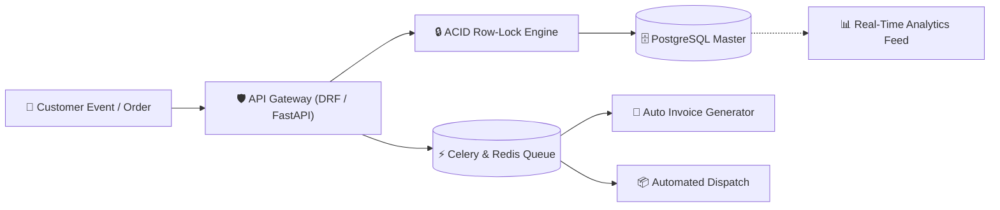

<div align="center">

<!-- Animated Header Wave Banner -->


<!-- Animated Typing Subtitle -->
<p align="center">
  
</p>

<!-- Quick Action Badges -->
[](mailto:abrar.bauet@gmail.com)
[](https://linkedin.com)
[](https://github.com)
[](#)

</div>

<br/>

---

### 💡 The Core Value I Bring to Businesses

> *"Businesses don't crash from a lack of features — they crash when backends fail under traffic, stock desyncs, and manual operations slow down growth."*

I design **automated, fault-tolerant backend systems** that eliminate manual overhead, stop revenue leaks from concurrency bugs, and keep databases fast under heavy scale.

---

### 🚀 Business Impact & Automation Matrix

<table width="100%">
  <tr>
    <td width="50%" align="center">
      <h3>🤖 Workflow & Task Automation</h3>
      <p><b>Cut Hundreds of Manual Hours</b></p>
      <p>Replacing manual spreadsheets and dispatching with automated <b>Celery & Airflow pipelines</b> for zero-friction invoicing, inventory sync, and notifications.</p>
    </td>
    <td width="50%" align="center">
      <h3>🛡️ Zero-Leak Transaction Engine</h3>
      <p><b>Stop Lost Revenue & Overselling</b></p>
      <p>Using <b>PostgreSQL Row-Level Locking (ACID)</b> to eliminate flash-sale race conditions, duplicate billing, and stock desync.</p>
    </td>
  </tr>
  <tr>
    <td width="50%" align="center">
      <h3>⚡ High-Throughput Performance</h3>
      <p><b>Faster Checkouts, Higher Conversions</b></p>
      <p>Refactoring bottlenecks and deploying <b>Redis Caching</b> to slash database query latency by <b>45%+ (sub-500ms response)</b>.</p>
    </td>
    <td width="50%" align="center">
      <h3>📊 Single Source of Truth</h3>
      <p><b>100% Reliable Business Data</b></p>
      <p>Delivering <b>99.8% accurate KPIs</b> directly to leadership dashboards with automated data validation and normalized schemas.</p>
    </td>
  </tr>
</table>

---

### 🏛️ Automated Business Architecture Blueprint



---

### 🧰 Tech Arsenal

<div align="center">

<p><b>Backend & Architecture</b></p>
<a href="https://skillicons.dev">
  
</a>

<br/>

<p><b>Databases & Transactional State</b></p>
<a href="https://skillicons.dev">
  
</a>

<br/>

<p><b>Automation, Queues & DevOps</b></p>
<a href="https://skillicons.dev">
  
</a>

</div>

---

### 📊 Production Track Record

<div align="center">

```
┌───────────────────┬───────────────────┬───────────────────┬────────────────────────────┐
│  ⚡ 45% Drop      │  📦 1M+ Records  │  🛡️ 99.9% Uptime  │  🔒 0 Overselling         │
│  In Query Latency │  Processed Daily  │  Enterprise SLAs  │  Atomic Row Locks          │
└───────────────────┴───────────────────┴───────────────────┴────────────────────────────┘
```

</div>

---

### 🤝 Let's Scale Your Business Backend

Have an upcoming platform, database bottlenecks, or manual processes you want to automate?

<div align="center">

[](mailto:abrar.bauet@gmail.com)
[](https://linkedin.com)

<picture>
  <source media="(prefers-color-scheme: dark)" srcset="https://raw.githubusercontent.com/<YOUR-USERNAME>/<YOUR-USERNAME>/output/github-contribution-grid-snake-dark.svg">
  <source media="(prefers-color-scheme: light)" srcset="https://raw.githubusercontent.com/<YOUR-USERNAME>/<YOUR-USERNAME>/output/github-contribution-grid-snake.svg">
  /<YOUR-USERNAME>/output/github-contribution-grid-snake.svg">
</picture>

<br/><br/>

<!-- Animated Footer Wave -->


</div>
